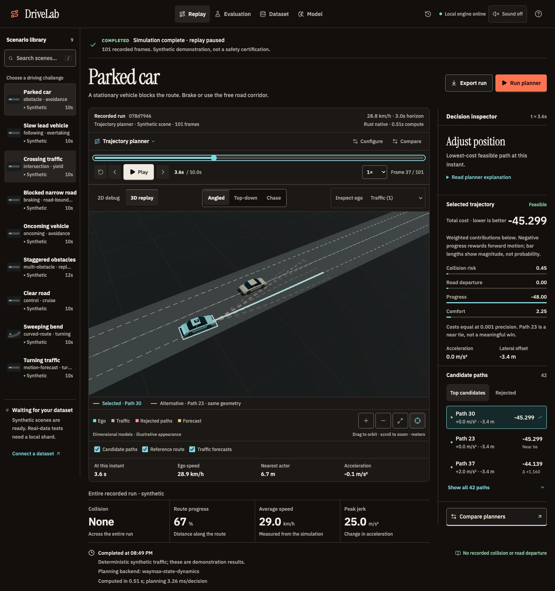

# DriveLab

A driving planner with a visual replay workspace. Run a route-following baseline and a receding-horizon trajectory planner on the same scene, inspect candidate trajectories, and compare measured failures and comfort.

React/TypeScript and Three.js visualization · Python simulation/API · Rust
trajectory scoring · optional PyTorch motion forecasting. An experimental
research/portfolio workbench, not a deployable self-driving system or safety certification.

## Run locally

Requires Python 3.12, Node.js 22.12 or newer, and npm. Rust/Cargo is optional for native trajectory scoring.

    make setup
    make waymax
    make ml
    make native
    make serve

Open http://127.0.0.1:8765. The UI is built and served by the Python API. For development, use make dev and open http://127.0.0.1:5173.

The setup target installs the basic simulation/API and viewer. The waymax target installs the pinned scientific environment for genuine Waymax stepping and local Waymo TFExample import. The ml target installs PyTorch for local training and learned traffic forecasting. The bundled scenes also support the NumPy engine when Waymax is absent; every report identifies the engine used.

The native target requires Rust/Cargo, builds the dependency-free Rust scoring library in release mode, and runs its Rust tests. Install a toolchain using the [official Rust instructions](https://rust-lang.org/tools/install/). The build script also recognizes this machine's project-local .cargo and .rustup directories without modifying your shell profile. If you omit native, automatic scoring falls back to NumPy; explicitly selecting Rust never silently falls back.

## Using the workspace

The default **3D replay** uses Three.js / React Three Fiber with original dimensional sedan, touring-ego and van geometry: bevelled shells, glass, wheels, lamps and an ego sensor pod. Use **Angled**, **Top-down**, or **Chase** (a native camera select on phones), drag to orbit, scroll or use buttons to zoom, and **Follow ego vehicle** to track the replay. Dragging disables follow; **Reset view** reframes the scene. Cars are clickable; keyboard users can use **Inspect ego** and **Inspect traffic actor**. **2D debug** keeps the precise SVG view. Switching views preserves the current replay frame, inspector selection and recorded report without rerunning the planner.

This is a renderer, not another driving simulator. Ground-plane footprints, positions, yaw, road polygons and overlays use existing scenario/frame data in meters. Model height, appearance and shadows are illustrative, not measured reconstruction. No decorative streets or invented buildings are added. The renderer redraws on demand while paused, and unsupported WebGL or renderer failures retain a usable 2D replay. Earlier CC0 Kenney assets remain in the repository with their source, license and hashes in web/public/models/kenney/ATTRIBUTION.md; the current vehicles do not depend on those meshes.

Select a scene from the scenario library. It runs the selected planner from the scene's initial state. Use **Configure** to adjust target speed, safety margin, and horizon, then **Run planner** to recompute. Play, pause, scrub, or step through the replay. Click a car to inspect its state. Select a candidate path to see its cost and rejection reason. **Compare planners** runs both on the current scene; **Evaluate library** runs both on every loaded scene.

Recorded collisions and road departures have clickable timeline markers. **Inspect first failure** jumps directly to the event. **Export run** opens a bounded summary with explicit actions to copy or download the full JSON, including frames and metrics. **Saved runs** in the header restores a persisted run without recomputing it. Space toggles replay; / focuses scenario search; Escape closes dialogs.

The Field Lab interface distinguishes planned settings, active requests, completed recordings, request errors and waiting prerequisites. Recorded receipts retain their original settings/scorer/timing; an older result remains explicitly previous while a new request loads. A completed run with a collision is not successful driving. **Pause** controls recorded playback only—backend computation has no pause/cancel endpoint. Interface click sounds are optional, off by default, and controlled by the persistent header toggle. Dataset artwork is a concept illustration, not measured scene reconstruction. UI audit, two critique rounds, screenshots and verification limits are in [design/ui-refresh/REPORT.md](design/ui-refresh/REPORT.md) and [design-qa.md](design-qa.md).

Amber dashed **Traffic forecasts** show the actual predicted actor positions used to score candidates at the selected instant, not the recorded future. Each path starts at the current actor position and ends at the planning horizon. Toggle the overlay independently of ego candidate paths. Older saved reports without forecasts remain readable, with that control disabled.

History and paired evaluations return lightweight summaries. Complete replay frames load only when needed; new full reports use lossless compression in SQLite. Existing uncompressed reports remain readable.

Settings are staged in the dialog and change only after **Apply settings**. A notice distinguishes new settings from an existing replay or evaluation; previously computed results keep their original settings.

## Rust trajectory scoring

**Configure → Trajectory scoring** selects automatic, Python/NumPy, or Rust native scoring. Rust accelerates batched oriented-box collision and clearance checks across candidate paths and predicted actors. Road checking, candidate generation, cost weights, forecast model, and simulation dynamics are unchanged. Automatic scoring resolves once per run. Reports record both the requested config.scoring and the actual scoring_backend; the replay and comparison show the recorded backend, not whichever setting you change afterward. Legacy reports say the scorer was not recorded.

The Python boundary validates finite float64 arrays and matching dimensions, creates contiguous buffers, verifies the library ABI version, and owns inputs/outputs for each call. The native boundary checks sizes, null pointers and nonfinite data before writing results; it never retains caller memory. Collision scoring uses padded ego boxes while clearance uses the actual unpadded footprint, matching the reference implementation.

Each new replay also shows its measured computation time and mean planner-decision time. The latter includes candidate generation, road checks and scoring, but excludes forecast inference and simulation stepping; total time includes those operations. These local wall-clock measurements are not a real-time safety guarantee. Legacy saved reports without timings remain readable and do not invent performance numbers.

To reproduce measured local performance:

    make benchmark

This writes data/scoring-benchmark.json with platform information, the native library hash, median timings, and numerical parity. It measures 42 candidates, 30/50 future poses and 5/32/128 actors, including input validation and the Python/Rust call. It separately times complete bundled-scene simulations. Scoring-kernel speedups are not full-system speedups, and neither measurement is a Waymo benchmark. Full rollout parity tests cover all nine scenes, both planners and both forecasting modes.

On the verified local macOS arm64 environment (Python 3.12.13, NumPy 2.0.2, release Rust build), nine-repeat kernel medians measured 19.3–22.6× faster scoring. Five-repeat complete simulation medians measured 1.53× on Parked car, 1.41× on Turning traffic, and 1.89× on Staggered obstacles. These are local synthetic measurements, not a promise for other hardware or dataset scenes. The reproducible report retains every median and the exact native library hash.

## Learned motion forecasting

The **Model** tab trains a compact PyTorch network on deterministic generated acceleration/turning trajectories. It predicts residual displacement relative to constant velocity using current speed, observed acceleration, observed yaw rate, and forecast time. Training and validation use disjoint full-trajectory seeds: 512 training trajectories and 256 held out, each evaluated across a five-second horizon. ADE is the mean displacement error across timesteps; FDE is the error at the final timestep. Both are measured in meters, not hardcoded scores.

Choose a seed and epoch count, click **Train on synthetic motion**, then **Use learned forecasting** and **Run planner**. The forecast can also be selected in **Configure**. Inference uses only current and past observations at 10 Hz. Missing history and motion outside the training range fall back to constant velocity; stationary and constant-speed straight trajectories are preserved exactly. Actor orientation remains its current observed yaw for collision scoring.

Use the **Turning traffic** scene to inspect an actual forecast-dependent change in candidate costs. The first step uses constant velocity because no history has been observed yet. Later observations reveal the actor's turn, allowing the trained residuals to change predictions. The straight-line and parked-obstacle scenes intentionally produce the same predictions under either mode; a learned model is not a universal improvement.

To train without the UI:

    .venv/bin/python scripts/train_forecast.py --seed 42 --epochs 100

The checkpoint persists at data/models/forecast.pt. The locally verified seed-42/100-epoch checkpoint measured approximately 0.94 m ADE and 3.28 m FDE, versus 10.33 m and 29.55 m for constant velocity on this synthetic validation distribution. Training does **not** use downloaded Waymo data, and these scores are **not** Waymo benchmark results. Better forecast error does not by itself imply safer planning; compare complete driving runs separately.

## Importing the dataset

Register for the [Waymo Open Motion Dataset](https://waymo.com/open/data/motion/) and download a small local **TFExample** shard. Waymo also distributes Scenario protobuf TFRecords; those have a different schema. This importer reads TFExample records.

In the **Dataset** tab, enter the absolute path to the downloaded shard and choose a bounded number of scenarios. Imported scenes persist in the local database and appear in the scenario library. The backend decodes using the official Waymax dataloader, extracts actors and static lane geometry, then applies planner decisions through Waymax dynamics.

The dataset stays on your machine. Raw data and generated local reports live outside source control. Dataset access is not bundled with this project. Synthetic scenes and generated TFExample test fixtures are always distinguished from downloaded Waymo data.

## Planning and evaluation

The planner projects the current ego pose onto a route and generates combinations of acceleration and lateral target. It rolls each candidate forward, predicts other actors using constant velocity or the trained residual model, and scores safety-margin overlap, departure from road geometry, route progress, and acceleration/lateral comfort. It executes the first step and replans at 10 Hz.

The baseline tracks the same route and requested speed without obstacle avoidance. Both planners receive the same initial state, route, and current observations. Recorded future actor positions stay inside the simulator. Evaluation uses oriented-box overlap, sampled road-footprint checks, distance along the route, mean speed, minimum clearance, and vector jerk. Reports retain chosen and rejected candidates so individual decisions are inspectable.

Road checks sample the four footprint corners, edge midpoints, and center. Collision checks include intermediate samples between the 10 Hz frames. This finite sampling is not a continuous safety guarantee. Clearance values are capped at 100 meters; the viewer displays that cap explicitly.

Bundled scenarios are deterministic synthetic demonstrations. They cover stopped obstacles, slow leading traffic, crossing traffic, narrow corridors, and other driving situations. Their outcomes are computed, not published benchmark scores.

For imported scenes, surrounding actors replay recorded motion and do not react to the ego vehicle. TFExample lane geometry needs a width approximation for road polygons and a heuristic map continuation for the route. Traffic signals are not currently enforced. The planner uses direct pose updates through Waymax; it is an experimental planning system, and kinematic feasibility must be assessed separately from collision avoidance. These limitations matter when interpreting results.

## Verification

Build the UI, then run the tests:

    make build
    make native
    DRIVELAB_REQUIRE_NATIVE=1 .venv/bin/python -m pytest backend/tests -q
    cd web
    npx playwright install chromium
    npm run test:e2e

The browser tests start a separate API on port 8766 with its own database and model checkpoint. They exercise actual backend runs, playback, seeking, candidate and actor inspection, explicitly applied configuration changes, failure jumps, JSON export, persisted-run restoration, paired evaluation, import errors, real model training and forecast overlays, scorer switching/parity and mobile layout. Install the ml, native and waymax targets before running the full integration suite. Running pytest without a built Rust library skips the optional native-specific tests; DRIVELAB_REQUIRE_NATIVE=1 makes its absence a failure. CI requires the native implementation.

From the project root:

    .venv/bin/python scripts/verify_waymax.py

The independent verifier constructs synthetic Waymax states, runs real compiled dynamics, checks overlap/off-road metrics, tests bounded-history observations against altered future values, and generates a synthetic TFExample to exercise the official loader. Passing this proves integration behavior; a downloaded dataset run is a separate verification step.

For a bounded paired check against your downloaded TFExample shard:

    .venv/bin/python scripts/verify_dataset.py /absolute/path/to/shard --kind waymo --limit 1 --report data/waymo-verification.json

This reads the source without changing it, records its SHA-256, decodes the selected scenarios, runs both planners through the complete finite Waymax horizon, and saves measured metrics with frame counts and timings. Failures and collisions are reported, not hidden or treated as proof of a broken loader. Add --prediction learned to use the trained checkpoint.

Use --scoring numpy or --scoring rust to verify an explicit scorer. Automatic scoring is the default; each planner's output identifies the scorer that actually executed.

Input provenance is explicit: --kind defaults to unknown; --kind waymax-fixture identifies an official repository test fixture without claiming it is your downloaded dataset. Generated synthetic markers always take precedence, even if the caller specifies --kind waymo. A successful check is evidence of decoder/runtime compatibility, not an autonomous-driving safety benchmark. Twenty scenarios from Waymax's repository fixture have additionally completed 40 paired rollouts under each scorer with matching final metrics. Some fixture runs collide; these failures are preserved in the reports. This does not replace the outstanding downloaded-data check.

## Interface motion and design evidence

Help → Interface motion follows your device preference by default. Full motion is a session-only preview; Reduce motion is remembered. Camera moves are presentation only: recorded poses, timestamps and results stay exact. Pause stops playback, not backend computation. Interface sounds are opt-in.

    npm run test:motion --prefix web
    npm run build --prefix web

The motion tests run without launching a browser (Node22.12+ with experimental type stripping). See [UI audit and before/after](design/ui-refresh/REPORT.md), [motion verification](design/motion/REPORT.md), and [living motion plan](plan.md) for scope, independent critiques and remaining test gaps.

The latest [Technical Noir refinement and before/after](design/noir-refinement/REPORT.md)
covers original visual models, eight-width responsive checks, two independent
screenshot critique rounds and browser interaction checks. Its local build and
28 motion/geometry unit tests passed; physical-device performance, cross-browser
coverage and the full E2E suite were not verified in that refinement. Run its
unit checks with:

    npm run test:motion --prefix web
    npm run test:models --prefix web

## Project layout

    backend/drivelab/   API, scenario library, planner, geometry, simulation, SQLite, Waymax adapter
    backend/tests/      Geometry, simulation, API, persistence, and Waymax integration tests
    native/             Dependency-free Rust collision/clearance scorer and C ABI
    web/src/            React/TypeScript replay workspace and SVG road viewer
    web/tests/          Playwright tests against the running app
    scripts/            Development launcher, model training, and independent Waymax verifier
    data/               Local SQLite database and generated data (ignored by Git)
    EXECPLAN.md         Living implementation and validation record

The current project includes classical candidate planning, optional synthetic-trained motion prediction, simulation, measured evaluation, a benchmarked Rust scoring component, and the interactive viewer. A downloaded Waymo shard still needs a separate real-data verification run. Model training remains explicitly synthetic; native speedups do not establish improved driving safety.
