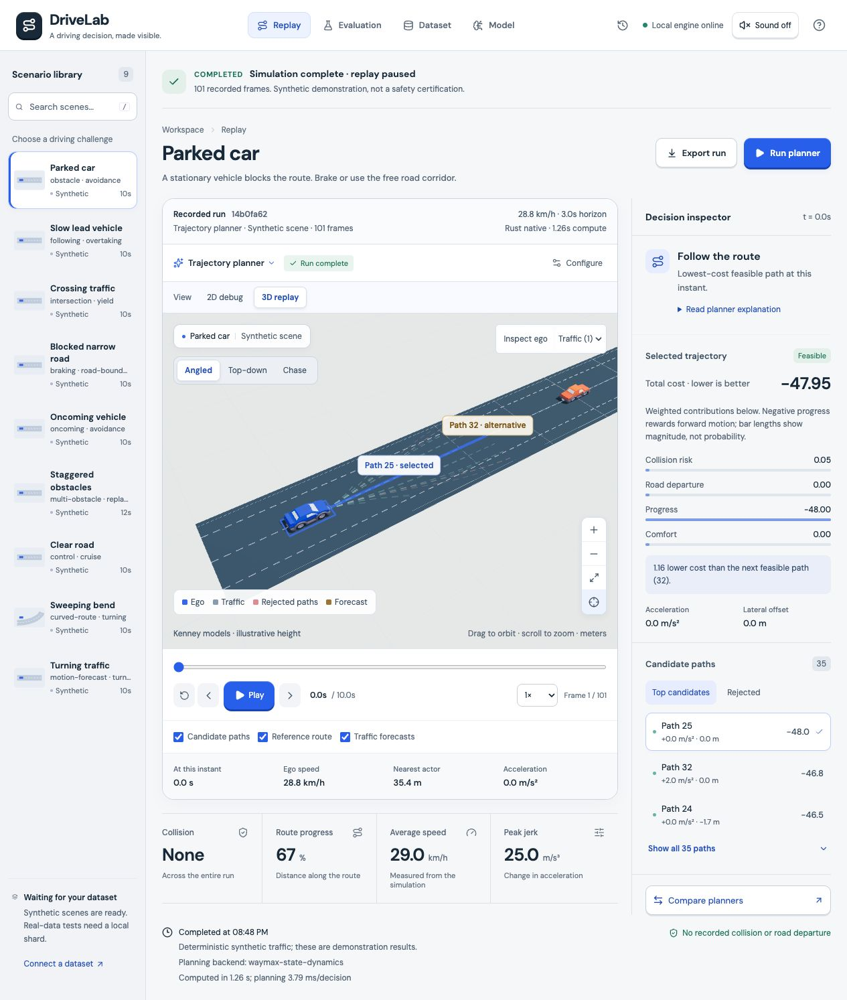
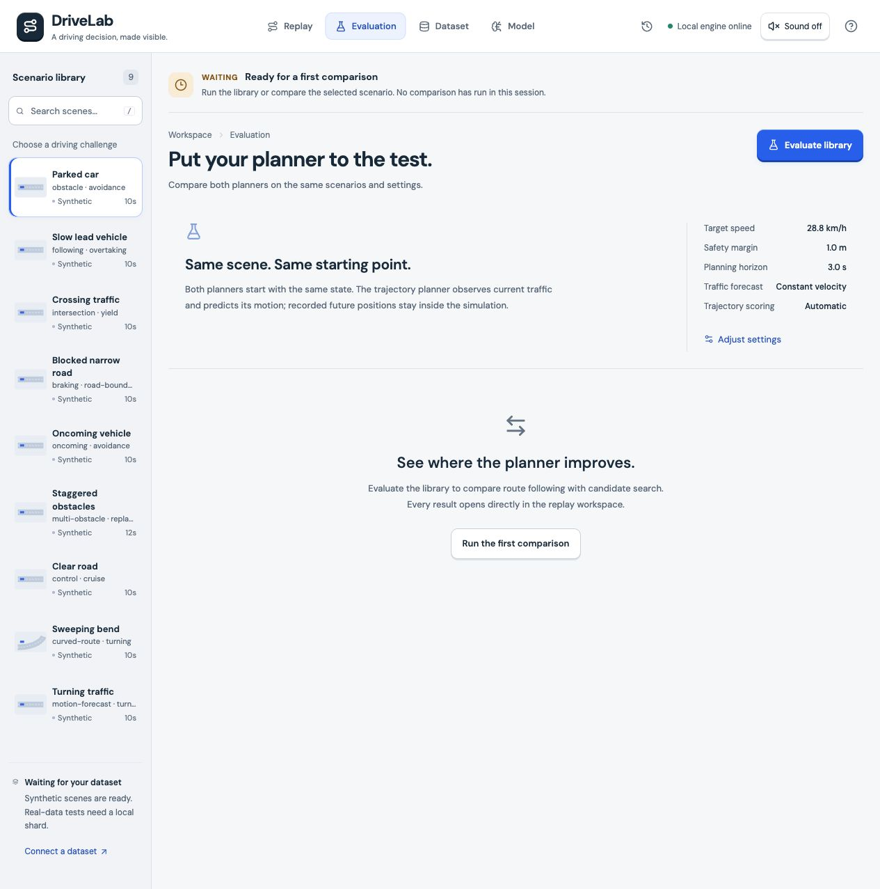
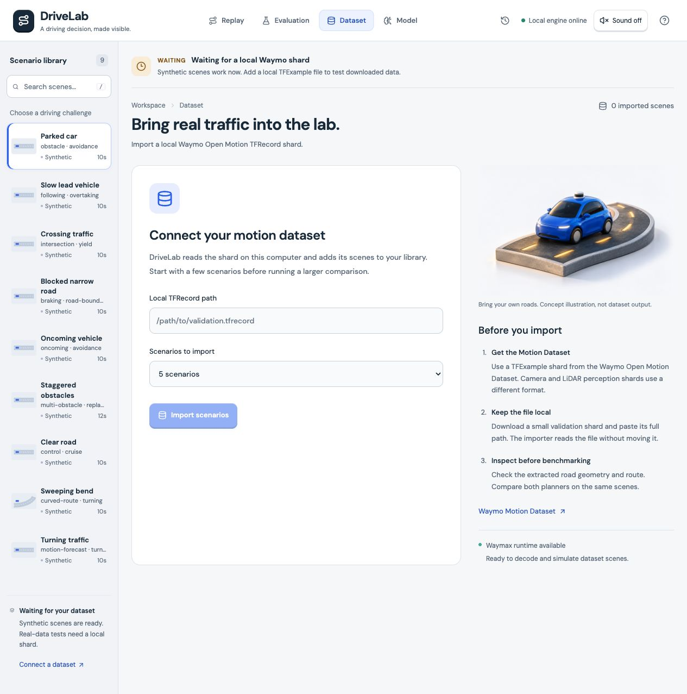
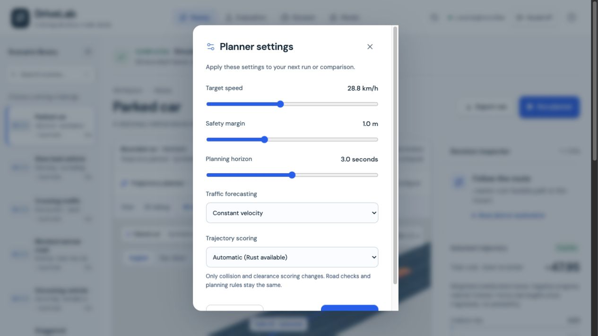
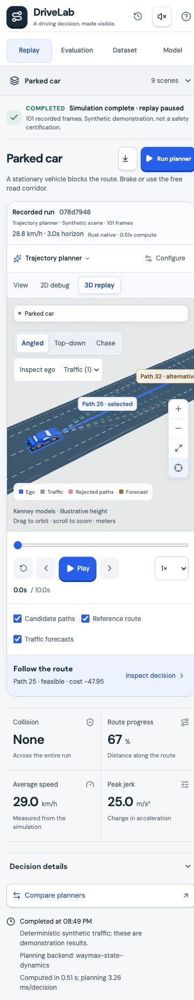

# DriveLab · Hallmark first pass

Captured October 5, 2026 (America/Edmonton). Scope: install Hallmark, study public references, and audit the current app. No production source changes. Hallmark v1.1.0 was installed from Nutlope/hallmark into the personal skills directory; automatic discovery applies on the next turn.

## Outcome

Recommend a **precision cockpit**: retain DriveLab's light porcelain, ink, and cobalt character; prioritize the real 3D visualization, synchronized decision evidence, and one transport dock. Add tactile control consistency rather than extra decorative 3D. Hallmark's Study workflow stops at a diagnosis and confirmation before implementation. This report is not a locked design.md or an implemented redesign.

## Primary tasks and current evidence

The user chooses a scenario and planner, computes a run, inspects recorded frames and candidate costs, compares planners, and optionally imports Motion Dataset scenes or trains a synthetic motion predictor. Playback is separate from simulation computation. Pause playback must not imply cancellation of a running computation.

| Question | Current support | Opportunity |
| --- | --- | --- |
| What is happening now? | Status explicitly says simulation complete and replay paused/playing. | Consolidate repeated completion labels; keep this distinction near transport. |
| What completed, with what evidence? | Run ID, recorded frames, config, scoring backend, timings, whole-run metrics, candidate costs, and export affordance. | Bring scoped outcome evidence closer to the scene instead of burying it below the replay. |
| What is blocked? | Dataset empty state identifies a missing local shard; settings disable unavailable learned forecasting. | Surface prerequisites beside the relevant action, not as repeated generic warnings. |
| How can I inspect or change direction? | Timeline, actor/candidate selection, camera controls, settings, comparison, export, and playback pause. | Reduce control fragmentation; distinguish next-run settings from recorded-run settings. |

The default scene is a synthetic demonstration. These measurements are not a real-world safety certification. In the desktop capture, run 14b0fa62 contains 101 frames; collision None, progress 67%, mean speed 29.0 km/h, peak jerk 25.0 m/s³. A recovered browser tab automatically produced a second synthetic run, 078d7946. Its compute time is not a controlled benchmark against the first run.

## Observed flow

### 1. Replay · healthy state communication, overloaded presentation

Status distinguishes recorded completion from playback. The scene and candidate inspector are genuine data views. Run receipt, planner row, view switch, camera controls, actor controls, legend, timeline, overlays, and telemetry fragment the primary task.

### 2. Evaluation entry · understandable, but biased empty-state wording

Waiting state correctly says there is no completed comparison in this session. Two competing evaluation buttons and the headline “See where the planner improves” presume a favorable result before measuring it.

### 3. Dataset entry · clear prerequisite and honest illustration

The local TFRecord path is empty; import is disabled, and zero imported scenes are shown. The concept illustration is explicitly not dataset output. It occupies more space than useful format guidance; replace or reduce it only if a real evidence preview helps onboarding.

### 4. Settings · action visibility needs repair

At the captured desktop viewport, the dialog's inner scroll places Reset defaults and Apply settings partially below its visible bottom. Keep a pinned action footer and scroll only the controls. Escape closes the dialog and returns focus to Configure; this was verified without applying settings.

### 5. Mobile replay · usable disclosures, primary transport too low

The scenario library and inspector collapse appropriately. Metadata and scene controls take substantial vertical space, placing playback below the first screen at the tested 375 CSS-pixel viewport. The alternative-path label is clipped in the capture. DOM measurements did not establish horizontal document overflow; do not generalize this to every breakpoint.

## Five biggest UI problems

1. **The useful outcome evidence comes too late.** Large scene/chrome stacks precede whole-run results. Put a compact, scoped result strip near the scene header: “Synthetic · this recorded run,” collision, progress, comfort, and a link to full evidence. Preserve units and provenance. Source: web/src/App.tsx:329 and :342.
2. **Controls are spread over too many horizontal layers.** Receipt, planner, view mode, camera mode, actor selection, overlays, and transport each have their own region. Give the scene one compact toolbar and one transport dock; move secondary controls into a clearly labeled view menu. On mobile, keep play/pause and time directly adjacent to the scene. Source: web/src/App.tsx:329–340; web/src/field-lab.css:54 and :58.
3. **Settings completion is hidden behind scrolling.** Users can inspect a setting but cannot immediately see how to commit it. Make the controls region scroll and keep Apply/Cancel visible. Keep clear “next run” copy and the existing focus-return behavior. Source: web/src/App.tsx:394–400; web/src/field-lab.css:92.
4. **Evaluation copy promises improvement without evidence.** Replace “See where the planner improves” with “Compare planner outcomes.” Use one primary action, clearly scoped to the scenario library; retain paired initial-state and synthetic-data caveats. Source: web/src/App.tsx:362 and :377.
5. **The 3D scene is more legible as depth than as a decision comparison.** Faint overlapping trajectories and incomplete selected/alternative legend mapping make the important difference hard to see. Frame the relevant vehicles and planning horizon more tightly; use a shared selected/alternative/rejected/forecast encoding across scene, legend, and inspector. Clamp labels within the canvas. Do not invent LiDAR, camera feeds, or prediction accuracy. Screenshot evidence: steps 1 and 5.

## Hallmark-specific findings

These are sampled findings, not a claim that all 58 gates passed. Marketing-layout preferences do not automatically apply to this technical application.

- **Major · Mid-render token improvisation, adapted as a maintenance risk.** Where: web/src/field-lab.css:2–19 and :35–92. Named root tokens coexist with repeated hard-coded surface, state, and border colors. No Hallmark theme had been locked, so this is not a claim of violating a prior contract. Fix: consolidate named semantic tokens and shared controls before adding another visual layer.
- **Minor · Centred everything, local to the evaluation empty region.** Where: web/src/App.tsx:377; web/src/field-lab.css:88. A large centered empty panel repeats the action already in the header. Fix: make the empty guidance a compact, left-aligned explanation tied to the single evaluation action. This is a task-hierarchy issue, not a prohibition on all centered layouts.

**0 critical · 1 major · 1 minor. Verdict: retain the useful data workspace; make targeted hierarchy and control changes, not a wholesale template replacement.** The five UX findings above are separate from this narrower catalogue count.

## Reference study · primary structure

Source: [Foxglove visualization](https://foxglove.dev/product/visualization). Evidence is a saved screenshot of its public product demonstration, not a signed-in live workspace. Study mode is image-based: exact fonts, color values, and motion behavior are unknown.

The closest Hallmark structure is **Workbench**, with Map/Diagram as a secondary fit; the capture shows the product, not a complete landing-page hierarchy. Compact panel headers divide concurrent evidence, while a single bottom transport ties the workspace together. The canvas is operational rather than ornamental. Typography reads as a neutral grotesque with compact technical labels; exact font identities are not inferred. The surface is dark, neutral-cool, with lightness elevation and hairline separators. Signal colors encode different information rather than one universal brand accent. Density is high and the grid is asymmetric. Hero, pitch, and footer archetypes are not visible in this bounded capture. Motion is not verified by a still image. Borrow the synchronized scene/inspector/transport relationship, not the number of panels, Foxglove branding, or data types DriveLab does not possess.

The closest catalogue cousin is Terminal for dark technical density, but the screenshot does not use a mono-everywhere/phosphor aesthetic. This is not a theme recommendation: retain DriveLab's current light surface.

## Secondary reference · controls only

Source: [Raycast](https://www.raycast.com/). Evidence is a public product showcase, not a verified native-app interaction. Its selected command row, consistent radii, restrained elevation, keyboard hints, and bottom action grouping make control state easy to scan.

Borrow selected/pressed/focus clarity and shallow control depth. Do not combine the entire Raycast layout with Foxglove's structure. Do not reproduce red glows, simulated OS chrome, or promotional copy. A still capture cannot establish click feel or sound quality.

## Independent screenshot-only critique

A fresh critic received only the five app screenshots and the user goals, not implementation rationale or project source. Its three findings were: essential controls compete with tall content and clip; 3D depth is clearer than trajectory differences; evidence scope is weaker than outcome presentation. The first two map directly to priorities above. Its suggestion to reduce the dataset illustration is reasonable but lower priority than fixing the replay workflow. Its clipping observation is screenshot evidence, not proof of document overflow or a responsive test suite.

No two implementation-and-improvement rounds occurred: this approved scope is installation plus study/audit, and no UI changes were made. This independent critique is a pre-implementation review, not a completed redesign verification.

## Recommended trial

Implement the precision cockpit on Replay first. Keep the existing React/TypeScript/Three.js stack and native motion system. Use one coherent spacing scale and semantic color/control tokens, a compact run receipt, tighter scene framing, a single transport area, an evidence strip, and the current decision inspector. Keep secondary information in explicit disclosures. Use subtle bevel/pressed depth; preserve instant keyboard focus and reduced-motion behavior. Retain opt-in interface sounds; audition before changing them. Do not add generated imagery or shaders unless they communicate something the real scene cannot.

After confirmation, validate dialog scrolling, keyboard focus, play/pause, scrubber synchronization, candidate selection, long scenario names, empty/loading/error states, mobile placement, and reduced motion. Then capture fresh after screenshots and perform two critique-and-fix rounds. Keep simulation cancellation claims out unless an actual cancellation capability exists.

## Verification and limits

Verified in the browser this pass: Replay/Evaluation/Dataset navigation; Configure opening; Escape dismissal and focus return; Play changing status to replay playing and advancing frame/time; Pause returning status to replay paused. The final app tab remains open and paused. The preview server was restarted because it was initially unavailable.

Not verified this pass: dataset import, learned-model training, paired comparison execution, export download, sound audibility, animation smoothness/frame rate, measured color contrast, full keyboard traps, all responsive widths, forced failure paths, full accessibility conformance, production build or automated tests. Code inspection found explicit planned/running/completed/failed/waiting branches, but that is not end-to-end proof of every state.

The app automatically computed synthetic runs on load/recovery; no manual Run planner, comparison, training, import, or settings-apply action was taken. The concept illustration is existing work, not generated during this audit.

Next decision: approve the Replay-first precision cockpit, or change its light/dark, density, or tactile-treatment axis before implementation.
