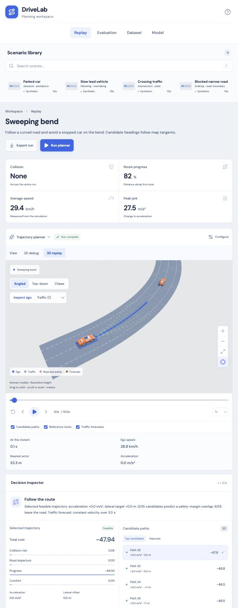
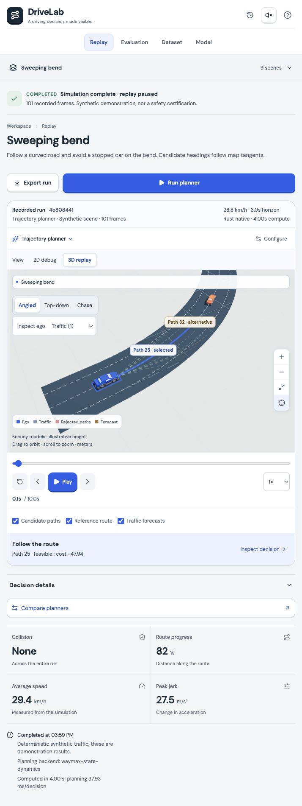

# DriveLab UI refresh — 3 October 2026

Implemented the Field Lab direction in the existing React/TypeScript/Three stack. All screenshots below were captured from the running app, not generated mock results. Two independent screenshot-only critique rounds were completed and their fixes implemented. Frontend type-check and production build pass. Browser verification is bounded; limitations are listed below.

## Primary tasks and initial audit

The real tasks are: choose a scene, configure and run a planner, inspect recorded decisions and failures, compare planners, connect a local dataset, and inspect/train a synthetic motion model.

Five largest problems in the original screens:

1. **The replay was visually subordinate.** Headlines, metric cards and toolbars pushed the driving scene away from the primary task. The new layout makes the road and transport the central surface; aggregate results follow it.
2. **Completion lacked nearby evidence.** Run identity, provenance, scoring backend and timing were separated from the result. A compact recorded-run receipt now accompanies the replay, distinct from the next settings.
3. **Missing prerequisites were passive numbers.** Zero imported scenes did not clearly explain the waiting state or next action. Dataset waiting now names the local-shard requirement and links to its form.
4. **Controls and meanings were scattered.** Playback, candidate overlays and compute controls competed. Transport is grouped; selected and alternative paths carry actual IDs; playback pause is explicitly not computation cancellation.
5. **Dense secondary text and repeated containers weakened legibility.** Small gray labels and stacked cards had little hierarchy or personality. The refresh uses consistent type, spacing, open inspector sections, restrained elevation and one purposeful illustration.

## Three proposed directions

| Direction | Layout and hierarchy | Type and palette | Tradeoff |
| --- | --- | --- | --- |
| **Field Lab — selected** | Compact library, large sculptural replay, open decision inspector, receipts above and outcomes below | Rounded geometric sans with tabular figures; porcelain, ink, cobalt and amber | Balances visual personality with long-form evidence; uses more vertical space than a dense table |
| Night Test Track | Immersive dark canvas, floating transport dock, expandable drawers | Technical sans; navy, cyan and warm warning colors | Cinematic but dense tables/forms and overlay contrast require more care |
| Experiment Notebook | Run ledger and evidence tables lead; replay is an analytical detail pane | Humanist sans with editorial serif accents; warm paper, charcoal and restrained green | Excellent for comparisons, less immediate visual impact for understanding driving motion |

The user requested recommendation followed by implementation, so Field Lab proceeded without a selection pause. Concepts are art-direction studies, not claims about measured outcomes: [Field Lab](concept-field-lab.png), [Night Track](concept-night-track.png), [Notebook](concept-notebook.png).

## Implemented visual and interaction system

Porcelain `#f6f7f9`, white, ink `#182a39`, cobalt `#285fea`, amber `#f4ae46`, steel separators; consistent 4/8/12/16/24/32 rhythm, DM Sans, tabular numbers, readable labels, raised pressable controls, visible focus, reduced-motion rules, and opt-in quiet click sounds (off by default).

Existing locally bundled CC0 Kenney vehicles remain. Render-only paint/shading gives the ego car a cobalt body while retaining windows, lamps and tires. Road geometry and path labels come from actual scene/frame data. No fake city, physics, progress percentages or safety claims were added. Generated art is project-bound at `web/public/art/field-lab.png`, labeled as a concept illustration on the dataset screen; it is not reconstructed dataset output.

## State and evidence contract

| State | Actual trigger | User-facing evidence or action |
| --- | --- | --- |
| Planned | Settings differ from an existing recording | Existing receipt retains its settings; Run planner applies the new direction |
| Running | Simulation, paired evaluation, import, training or saved-run loading request active | Names the activity; previous result is explicitly previous; no fake completion percentage |
| Completed | Server returned a report/comparison/checkpoint | Recorded ID, frames, source, original settings, backend and measured timing/metrics |
| Completed with recorded failures | Returned simulation contains collision/road departure | Failure wording, red metric and clickable timestamp; completing computation is not successful driving |
| Failed | Actual request error | Error message and retry/dismiss action; no new verified result implied |
| Waiting | No local dataset, no comparison yet, or missing model prerequisite | Named prerequisite and relevant next action, not an ambiguous pause symbol |

Inspection supports 2D/3D, three cameras, actor selection, candidate selection, actual weighted costs, explanation disclosure, rejected reasons and failure jumps. Configure changes direction. Pause stops **recorded playback only**; there is no backend cancellation capability. Saved runs restore evidence without recomputation.

## Independent critique rounds

The isolated critic received only user goals/design brief and screenshots—no code or implementation rationale. Findings below are condensed, not verbatim quotations.

### Round 1

Evidence: `round1-desktop.jpg`, `round1-replay.jpg`, `round1-dataset.jpg`, `round1-model.jpg`, `round1-evaluation.jpg`.

1. **Recorded vs next settings ambiguous:** model epoch input could be mistaken for the saved checkpoint's training; run evidence was too far away. Added separate next-training/recorded-checkpoint labels and recorded-run receipts; waiting uses a clock rather than pause.
2. **Costs lacked meaning:** signed weighted values and candidate differences were unexplained. Added lower-is-better language, negative progress reward/magnitude explanation, feasible-alternative gap and concrete rejected reasons.
3. **Mobile decisions were separated from playback:** added a nearby decision summary and focusable Inspect decision action; detailed costs use disclosure on mobile.

### Round 2

Evidence: `round2-desktop.jpg`, `round2-mobile.jpg`, `round2-model.jpg`.

1. **Library/candidate layout clipped or overlapped:** removed nested clipping of library rows and separated the comparison footer from candidate results; saved history stays accessible in the header.
2. **3D path identities were missing:** actual selected and next-feasible path IDs are now world-anchored labels, with a cobalt selected line and amber dashed alternative.
3. **Secondary text and transport hierarchy were weak:** increased contrast/type readability and grouped labeled Play, time and speed controls.

Final browser checks additionally fixed restoration text (opening a recorded run is not computing a new one), baseline explanation (no candidate search), large-report preview performance and world-label/modal stacking.

## Verification this turn

- **Passed:** `npm run build --prefix web` (TypeScript and Vite), including final restoration-copy fix.
- **Browser verified:** actual scenario runs; settings staged → planned → running → returned completion; play/pause/step; camera and actor/candidate selection; rejected reasons; 2D/3D switching; saved-run loading/restoration; failure jump to baseline collision at 4.3 seconds; actual one-scenario paired comparison; missing-file import error and dismissal; zero-dataset waiting; search empty/clear; existing checkpoint receipt; settings focus trap/Escape and export Escape/refocus; mobile inspect focus; sound toggle/persistence (returned to off).
- **Report preview:** full pretty JSON for one curved run was 13,747,726 characters and overwhelmed the original textarea/browser inspection. Final dialog shows a bounded summary, leaving explicit full JSON copy/download actions. Dialog now opens promptly and world labels stay behind it.
- **Responsive:** final 390px browser readback had innerWidth/clientWidth/scrollWidth all 390, with no horizontal overflow; final desktop capture at 1280px. Long scenario/history content and large numeric failure cost were inspected.
- **Console:** no error-level messages observed in the final browser check. Existing `THREE.Clock` deprecation warnings remain in dependencies.
- **Tests maintained, not rerun:** existing Playwright selectors/assertions were updated for receipt placement and the export dialog; no CLI browser suite or backend/Rust suite was rerun during this UI turn. Older test counts are not presented as current evidence.

### Unresolved or unverified

- Dataset count remains **0**. No downloaded Waymo shard/import/real-data validation is claimed.
- Model training was not rerun, preserving the existing checkpoint. Its displayed validation metrics are recorded synthetic results, not Waymo results.
- The copy request resolved in the UI, but clipboard contents were not round-trip verified. File-download completion could not be confirmed in the in-app browser.
- No backend job cancellation exists. Playback pause must not be interpreted as pausing training/computation.
- Sound preference/trigger behavior was checked; human audibility and reduced-motion media emulation were not tested.
- Lazy 3D chunk is approximately 1.05 MB minified / 285 KB gzip; Vite's size warning remains. It is separate from the main UI chunk.
- Browser screenshots are not an exhaustive accessibility or cross-browser audit. The screenshot-only critic could judge hierarchy and legibility, not functional or assistive-technology correctness.

## Before and after

These show the same logical Sweeping bend replay task at 0.1 seconds. Capture density/viewport differ (original 554×1411; final narrow 714×1900), so they demonstrate hierarchy rather than pixel-exact performance or size comparisons.

| Before | After |
| --- | --- |
|  |  |

Additional final evidence: [desktop](after-desktop.jpg), [mobile](after-mobile.jpg), [dataset](after-dataset.jpg), [model](after-model.jpg), [evaluation](after-evaluation.jpg), [report dialog](after-report.jpg), [collision evidence](state-run-with-failures.jpg). Original other screens: [dataset](before-dataset.jpg), [model](before-model.jpg), [evaluation](before-evaluation.jpg). State captures also include `state-planned.jpg`, `state-running.jpg`, `state-error.jpg`, `state-search-empty.jpg`, and `state-comparison-running.jpg`.

## Skill influence and implementation record

- [Product Design](/Users/dricmoybhattacharjee/.codex/plugins/cache/openai-curated-remote/product-design/0.1.56/skills/index/SKILL.md) audit/ideation/image-to-code/design-QA guidance structured the audit, three options, screenshot evidence and final QA.
- [Frontend Design](/Users/dricmoybhattacharjee/.codex/skills/frontend-design/SKILL.md) informed the purposeful visual hierarchy, coherent tokens and restrained effects.
- [Imagegen](/Users/dricmoybhattacharjee/.codex/skills/.system/imagegen/SKILL.md) produced the three visual studies and the actual project-bound illustration, instead of substituting decorative code drawings.
- [Execution Plan](/Users/dricmoybhattacharjee/.codex/skills/execution-plan/SKILL.md) kept scope, decisions, critiques and recovery steps in [EXECPLAN_UI.md](/Users/dricmoybhattacharjee/Desktop/drivelab/EXECPLAN_UI.md).

Source changes: `App.tsx`, `OperationStatus.tsx`, `feedback.ts`, `field-lab.css`, `main.tsx`, `Scene3D.tsx`, `Scene.tsx`, and maintained `workspace.spec.ts`. Existing backend functionality, datasets, models and persisted runs were preserved. Local verification created additional saved synthetic runs/comparisons; none were deleted.
